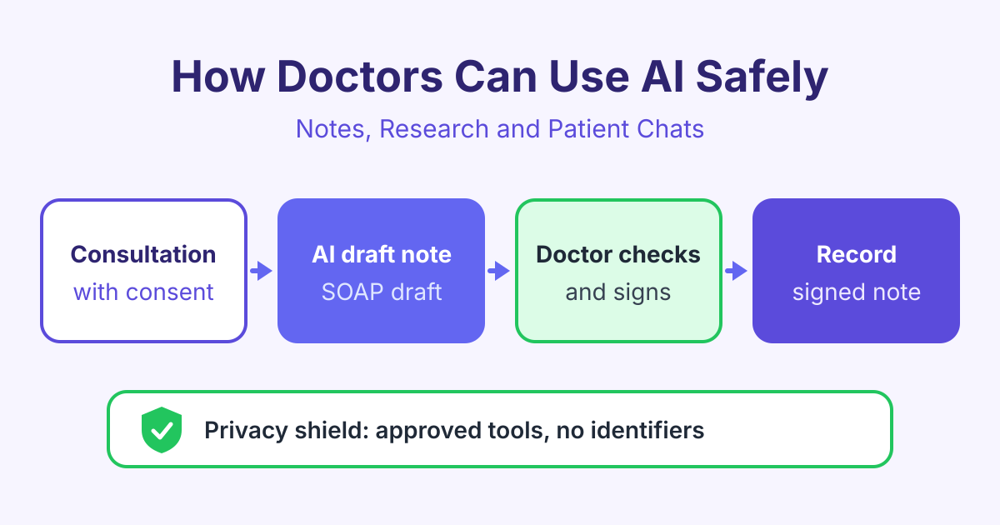

# How Doctors Can Use AI Safely: Notes, Research and Patient Chats

*AI for doctors can cut note-writing time, summarise research and draft patient messages. Learn the safe way to use it while you stay in charge of care.*

AI for doctors works best as a helper for writing and reading tasks: it drafts clinical notes, summarises research and prepares patient messages, and the doctor checks every word before it is used. Used this way, AI saves time without taking away the doctor's judgement or responsibility.

This guide explains the most useful tasks, the main risks and simple rules to follow. It is general information, not medical or legal advice. Always follow the rules of your hospital, clinic and country.

## What AI for doctors can do today

Most doctors spend a large part of the day on paperwork. AI tools based on large language models (LLMs) are good at turning messy text into tidy text. An LLM is a computer program trained on a huge amount of writing, so it can predict and produce natural-sounding sentences.

Common tasks where AI can help:

- **Clinical notes:** turning a consultation into a structured draft note.
- **Research:** summarising long papers and guidelines into short points.
- **Patient messages:** drafting clear, kind replies in plain language.
- **Imaging support:** some approved tools highlight areas on scans for a second look.

AI does not examine patients. It can sound confident and still be wrong. That is why the doctor always checks the result.

## AI medical documentation and ambient scribes

An **ambient scribe** is a tool that listens to a consultation (with the patient's consent) and writes a draft note. "Ambient" means it works quietly in the background, so you can look at the patient instead of the keyboard.

A good workflow looks like this:

1. Tell the patient you use a scribe tool and ask for consent.
2. Hold the consultation as normal.
3. The tool creates a draft note, often in a format such as SOAP (Subjective, Objective, Assessment, Plan).
4. You read the draft, fix errors and add your own clinical reasoning.
5. You sign the note. Only then does it go into the record.

Watch for common mistakes. The tool may mishear a drug name or a dose, mix up left and right, or add a symptom that was never mentioned. Read numbers, drug names and negatives ("no chest pain") with extra care.

If you want to practise this step by step, the [AI for Medical Documentation](/courses/ai-medical-documentation) course covers note templates, scribe review and letter drafting.

## Using AI to summarise medical research

AI can help you read faster, but it should not replace reading the key parts yourself.

Good uses:

- Ask for a short summary of a paper you have already found.
- Ask what the study design, sample and main limits were.
- Compare two guidelines on the same topic.

Be careful with general chatbots that answer from memory. They can invent references that look real but do not exist. This is called a **hallucination**: the AI makes up facts or sources. Always open the original paper, check the numbers and check the date of the guideline.

Here is an example prompt you could use with a paper you paste in (with no patient data):

> You are helping a doctor read a research paper. Summarise the paper below in 8 bullet points. Include the study type, number of participants, main outcome, key results with numbers, and the limits the authors mention. If something is not stated in the paper, write "not stated". Do not add facts from outside the text.

## Patient messages and chatbots

AI can help you answer patient emails and portal messages in plain, friendly language. It can also turn a complex care plan into simple steps a patient can follow.

Some clinics use patient chatbots for booking, reminders or general health information. These need clear limits:

- The chatbot should say it is an automated tool, not a doctor.
- It should send urgent symptoms to a human or to emergency services.
- It should not give a diagnosis or change treatment.

Read every AI-drafted reply as if you wrote it yourself, and check that the advice matches your plan.

## Patient privacy: the most important rule

Patient data is very sensitive. Before you use any AI tool, ask: "Is this tool approved by my organisation for patient data?"

Simple privacy rules:

- **Use approved tools only.** Your hospital or clinic should have checked the tool and signed the right contracts with the provider.
- **Remove identifiers** when you use a general tool. Identifiers are details that can point to a person, such as name, date of birth, address, phone number, record number or rare details about their case.
- **Follow local law.** In the United States, HIPAA sets rules for health data. In the UK and the European Union, GDPR protects personal data, and health data has extra protection. Other countries have their own laws.
- **Do not paste patient data into free public chatbots** unless your organisation has clearly allowed it.

## What you must check before you trust the output

The doctor stays responsible for every note, letter and decision. This table shows what to check for each task.

| Task | How AI helps | What you must check |
|---|---|---|
| Clinical note | Drafts a structured note from the consultation | Drug names, doses, negatives, left and right, your own reasoning |
| Research summary | Shortens a long paper into key points | Real source, correct numbers, date, study limits |
| Patient message | Writes a clear, kind reply | Advice matches your plan, safety-net advice, tone |
| Imaging support | Highlights areas for a second look | Your own read of the image, approved and validated tool |
| Referral letter | Pulls key facts into a letter | Correct history, allergies, current medicines |

Also think about **bias**. AI tools learn from past data, and that data may under-represent some groups of patients. Results may be less accurate for them. The [Safe and Ethical Healthcare AI](/courses/safe-healthcare-ai) course explains bias, consent and safe use in more detail.

## Frequently asked questions

### Is AI safe to use with real patients?

It can be, if you use tools your organisation has approved and you check every output. The risk comes from trusting AI without review or from sharing patient data with tools that are not approved. Treat AI output as a draft, never as a final answer.

### Can I paste patient notes into a public chatbot?

In most cases, no. Free public tools may store or use what you type, and this can break privacy law and your employer's rules. Use an approved tool, or remove all identifiers first if your rules allow it.

### Will AI replace doctors?

No. AI can help with writing, reading and some pattern-finding tasks, but it cannot take legal or ethical responsibility for care. Doctors still examine patients, make decisions and talk with patients about their choices.

### Who is responsible if an AI-drafted note contains an error?

The clinician who signs the note is responsible for what it says. That is why you should read each draft carefully before signing it.

## Start learning

You can learn these skills with short, practical lessons and real examples. Begin with [AI for Doctors in Clinical Practice](/courses/ai-doctors-clinical-practice) and build a safe AI workflow for your daily work.
