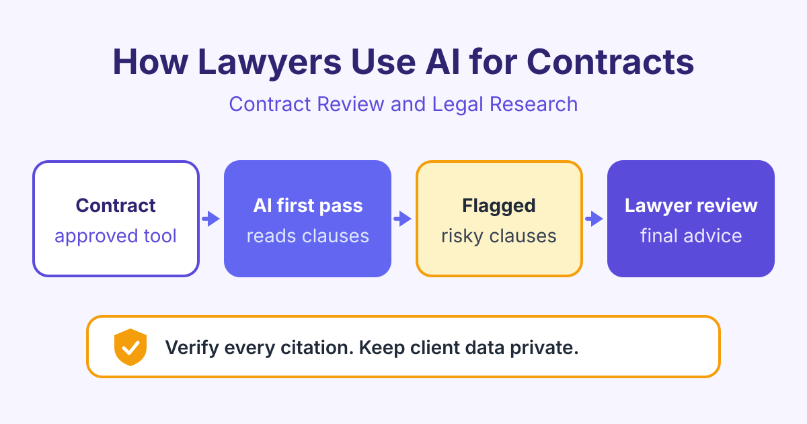

# How Lawyers Use AI for Contract Review and Legal Research

*AI for lawyers speeds up contract review, clause comparison and legal research. Learn practical uses, the risk of fake citations and how to stay safe.*

AI for lawyers is most useful as a fast first reader: it reviews contracts, compares clauses, summarises research and drafts documents, and the lawyer checks every result before it reaches a client or a court. AI saves time on routine reading, but the lawyer keeps full professional responsibility.

This guide explains where AI helps, where it can go wrong and simple rules to follow. It is general information, not legal advice. Always follow the rules of your firm, your regulator and your courts.

## What AI for lawyers can do today

Many AI legal tools are built on large language models (LLMs). An LLM is a computer program trained on a huge amount of text, so it can read, summarise and write in natural language.

Common tasks:

- **First-pass contract review:** reading a long agreement and pointing out key terms and risks.
- **Clause comparison:** checking a contract against your firm's standard terms or playbook.
- **Research summaries:** turning long judgments or articles into short points.
- **Drafting:** first drafts of letters, clauses, emails and memos.

AI does not understand your client's goals, the deal history or the judge in front of you. It works fast, but it cannot replace legal judgement.

## AI contract review: a practical first pass

**AI contract review** means using a tool to read a contract and flag clauses that need attention. A good workflow looks like this:

1. Use a tool your firm has approved for client documents.
2. Upload the contract and tell the tool what to look for, such as your playbook. A **playbook** is your firm's list of preferred terms, fallback positions and red lines.
3. The tool lists key terms and flags clauses that differ from the playbook.
4. You read each flagged clause in the original contract.
5. You decide what to accept, change or reject, and you write the advice.

Typical clauses to flag include limitation of liability, indemnity (a promise to cover another party's losses), termination, payment terms, governing law, confidentiality and automatic renewal.

Here is an example prompt you could use with an approved tool:

> You are helping a lawyer review a supplier agreement for the customer. List every clause about liability, indemnity, termination, renewal and data protection. For each one, quote the clause number and exact wording, explain it in one plain sentence, and say if it is unusual or one-sided. If a topic is missing from the contract, say "not found". Do not guess.

Asking for clause numbers and exact quotes makes the output much easier to check. The [AI for Contract Review](/courses/ai-contract-review) course shows how to build playbooks and review prompts like this.

## AI legal research and the problem of fake citations

AI can help you find a starting point, summarise a long judgment or explain an unfamiliar area of law in simple words. But general chatbots have a serious weakness.

They can produce **hallucinations**: confident answers with made-up facts. In legal work, this often means fake case names, wrong citations or quotes that no judge ever wrote. Courts in several countries have criticised lawyers who filed documents with invented cases from AI tools.

Simple rules for AI legal research:

- **Never cite a case you have not read** in a trusted legal database.
- **Check every citation:** the name, the court, the year and the exact quote.
- **Check that the law is still good:** it may have been overruled or changed.
- **Prefer tools linked to real sources,** which show where each answer comes from.

The [AI for Legal Research](/courses/ai-legal-research) course explains how to search, summarise and verify sources step by step.

## Client confidentiality and data safety

Lawyers must protect client information. Before you paste anything into an AI tool, ask: "Has my firm approved this tool for client data?"

Practical rules:

- **Use approved tools only.** Your firm should check how the provider stores, uses and protects data.
- **Do not paste client documents into free public chatbots.** Some tools may keep or learn from what you type.
- **Remove names and details** when you test ideas in a general tool. Replace them with labels such as "Party A".
- **Follow data protection law,** such as GDPR in the UK and European Union, and your local rules.
- **Check client terms.** Some clients ask firms to tell them, or ask permission, before AI is used on their matters.

## Professional duty: the lawyer stays responsible

Your professional duties do not change because you used AI. You are still responsible for competence, honesty to the court, confidentiality and the advice you give. Many regulators and bar associations have published guidance on AI use, so read the guidance that applies to you.

This table shows what to check for each task.

| Task | How AI helps | What you must check |
|---|---|---|
| Contract review | Flags risky or unusual clauses | Read each flagged clause yourself, look for missed clauses |
| Clause comparison | Compares terms with your playbook | Context of the deal, defined terms, cross-references |
| Legal research | Summarises cases and articles | Every citation exists, is quoted correctly and is still good law |
| Drafting | Writes a first draft quickly | Facts, tone, legal accuracy, client instructions |
| Client emails | Turns advice into plain English | Advice is correct and nothing confidential is sent wrongly |

Also think about billing. If AI saves you time, your fees should reflect the real work done, in line with your rules and your client agreement.

## Frequently asked questions

### Is it safe to use AI for contract review?

It can be safe if you use a tool your firm has approved and you check the results. AI may miss a clause or misread a defined term, so treat its output as a first pass. The final review and the advice are always yours.

### Why does AI make up case citations?

AI language models predict likely words, so they can produce text that looks like a real citation even when no such case exists. This is called a hallucination. Always confirm each case in a trusted legal database before you rely on it.

### Can I put client documents into ChatGPT or other public chatbots?

You should not do this unless your firm has clearly approved the tool and its data terms. Public tools may store what you type, which can break client confidentiality. Use approved tools, or remove all identifying details first.

### Will AI replace lawyers?

AI can do some routine reading and drafting faster, but it cannot give advice, take responsibility or understand a client's real goals. Lawyers who learn to use AI well can spend more time on judgement, strategy and client work.

## Start learning

You can build these skills with short, practical lessons and real examples. Start with [AI for Contract Review](/courses/ai-contract-review), then explore [Legal Ethics and AI](/courses/legal-ethics-ai) to use AI safely in your practice.
