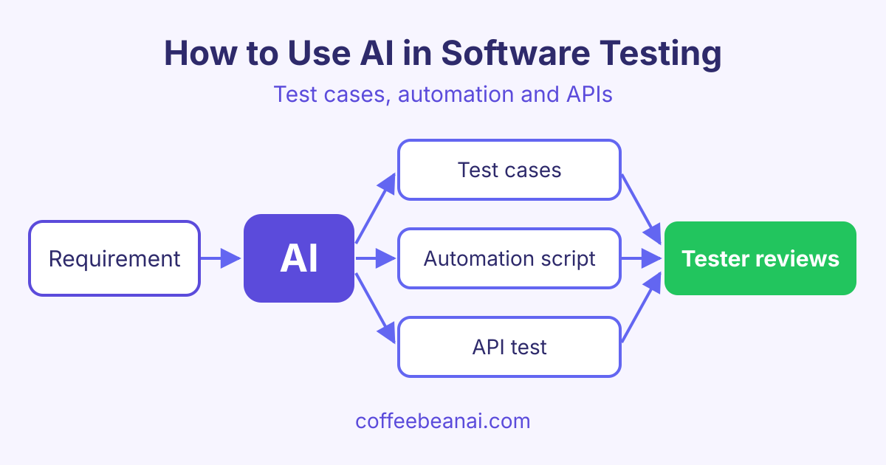

# How to Use AI in Software Testing: Test Cases, Automation and APIs

*Learn how to use AI in software testing to write test cases, create test data, build automation scripts and API tests, and what you must still check.*

AI in software testing means using an AI chat tool, such as ChatGPT, Claude or Gemini, to help you plan, write and fix tests faster. The AI does the first draft, and you, the tester, check it and decide what is right.



## What can AI do for testers?

AI is good at work that is repetitive and based on text. A lot of testing work is exactly that. Here are the most common uses of AI for testers:

- **Test cases:** turn a requirement or user story into a list of test cases.
- **Test data:** create sample names, emails, dates and edge cases.
- **Automation scripts:** draft code for tools like Selenium, Playwright or pytest.
- **API tests:** write requests and checks for a REST API (a way for programs to talk over the web).
- **Bug reports:** turn messy notes into a clear bug report with steps to reproduce.
- **Bug triage:** sort and group many bug reports by area and likely severity.

AI does not replace your testing skill. It saves time on typing, so you can spend more time thinking about risk.

## How to generate test cases from requirements with AI

A requirement is a short statement of what the software must do. AI can read it and suggest positive tests (the normal, happy path), negative tests (wrong input) and edge cases (values at the limits).

The key is a clear prompt. Give the AI the requirement, the format you want and the kind of tests you need. Here is an example prompt:

> You are a senior software tester. Here is a requirement: "Users can reset their password with a link sent by email. The link expires after 30 minutes." Write 10 test cases in a table with the columns ID, Title, Steps, Expected result and Type (positive, negative or edge). Include tests for an expired link and a link used twice.

Read every test the AI gives you. Remove ones that do not match your product. Add any rules the AI could not know, such as company policy or old bugs.

## Using AI to create test data

Good tests need good data. Typing hundreds of rows by hand is slow. AI can create them in seconds, in CSV or JSON (common text formats for data).

Ask for a mix of values:

- valid values, like a normal email address
- invalid values, like an email with no "@"
- boundary values, like a name that is exactly the maximum length
- special cases, like accents, emojis or very long text

Always ask for fake data. Never paste real customer details into an AI tool.

## AI test automation: writing scripts faster

AI test automation means using AI to help write and fix the code that runs your tests by itself. You describe the test in plain English, and the AI drafts the script. It can also explain an error message or suggest a fix when a test fails.

This helps beginners learn automation, and it helps experienced testers move faster. If you want to practise this step by step, the [AI Test Automation course](/courses/ai-test-automation) shows how to do it with real tools.

Watch out for these common problems in AI-written scripts:

| Problem | What to do |
|---|---|
| Wrong or made-up selectors (the way a script finds a button) | Check each selector in the real page |
| Fixed waits like "sleep 5 seconds" | Replace them with waits for an element or event |
| Old library functions | Check the current docs for your tool |
| Tests that only pass on your machine | Run them in your CI pipeline too |

## How to write API tests with AI

APIs are a great fit for AI because they are well defined. If you give the AI your API documentation, it can write tests for each endpoint (one address of the API, like /users). It can check status codes, response fields and error messages.

Here is a short pytest example that an AI might draft for a "create user" endpoint. Pytest is a popular Python testing tool.

```python
import requests

BASE_URL = "https://api.example.com"


def test_create_user_returns_201():
    payload = {"name": "Sam", "email": "sam@example.com"}
    response = requests.post(f"{BASE_URL}/users", json=payload, timeout=10)
    assert response.status_code == 201
    assert response.json()["email"] == "sam@example.com"


def test_create_user_without_email_returns_400():
    response = requests.post(f"{BASE_URL}/users", json={"name": "Sam"}, timeout=10)
    assert response.status_code == 400
```

You still need to check that 201 and 400 are the codes your API really returns. The [AI for API Testing course](/courses/ai-api-testing) covers this in more detail.

## Limits of AI in software testing

AI is helpful, but it makes mistakes. Keep these rules in mind:

- **Review every generated test.** AI can sound sure and still be wrong. It may test the wrong rule or miss an important case.
- **Watch for flaky tests.** A flaky test passes sometimes and fails other times without any code change. AI scripts often cause this with poor waits.
- **Do not share secrets.** Never paste passwords, API keys, tokens or real customer data into a prompt. Check your company rules first.
- **Keep the context small and clear.** Too much text can confuse the AI. Give it one feature at a time.
- **Own the result.** If a bug reaches users, "the AI wrote it" is not an excuse. The tester decides what is tested.

## Frequently asked questions

### Will AI replace software testers?

No. AI can draft tests and data, but it does not understand your users, your business or your risks the way you do. Testers who know how to use AI well will likely be more valuable, not less.

### Which AI tool is best for software testing?

Most popular AI chat tools can help with test cases, data and scripts. The best one is often the tool your company already approves. Try the same prompt in two tools and compare the results.

### Can AI write Selenium or Playwright tests?

Yes. AI can draft Selenium or Playwright scripts from a plain English description. You must still check the selectors, the waits and the library functions, then run the tests to make sure they work.

### Is it safe to paste my code into an AI tool?

It depends on the tool and on your company policy. Some tools may store or learn from what you type. Remove secrets and private data first, and use the approved business version if your company has one.

## Start learning

The best way to learn AI in software testing is to practise on real examples, one step at a time. Begin with the [AI for Software Testing course](/courses/ai-software-testing) and start writing better tests today.
