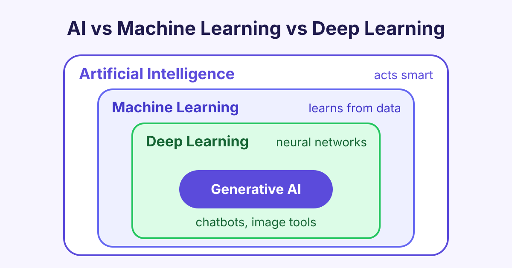

# AI vs Machine Learning vs Deep Learning: What Is the Difference?

*AI vs machine learning vs deep learning explained in simple English: what each one means, how they fit together, and where generative AI belongs.*

The short answer to AI vs machine learning vs deep learning is this: AI is the big goal of making computers act smart, machine learning is one way to reach that goal by learning from data, and deep learning is a type of machine learning that uses large neural networks. Each one sits inside the one before it.

People often mix up these three words. Once you see how they connect, AI news becomes much easier to follow.

## What is artificial intelligence (AI)?

**Artificial intelligence** (AI) is any computer system that does a task we normally think needs human intelligence. Examples are understanding speech, recognising faces, playing chess or planning a route.

AI is a very old idea. The name was first used in 1956, at a research workshop at Dartmouth College in the United States.

Early AI did not learn at all. People wrote the rules by hand. For example, a chess program could follow thousands of "if this, then that" rules. These are called **rule-based systems** or **expert systems** (programs that follow rules written by human experts).

Rule-based AI works well for simple, clear problems. But try writing rules that spot a cat in any photo, from any angle. It is almost impossible.

## What is machine learning (ML)?

**Machine learning** (ML) is a part of AI where the computer learns patterns from **data** (examples) instead of following hand-written rules.

To build a spam filter, you show the computer thousands of emails marked "spam" or "not spam". It finds the patterns by itself. The result is called a **model** (the learned pattern that makes predictions).

There are three main ways a machine can learn:

- **Supervised learning:** the data has the right answers (labels). Example: house prices from size and location.
- **Unsupervised learning:** the data has no labels. The model finds groups on its own. Example: grouping shoppers by buying habits.
- **Reinforcement learning:** the model learns by trial and error, with rewards for good actions. Example: a program learning to play a game.

Classic machine learning methods include **linear regression** (drawing the best straight line through data), **decision trees** (a chain of yes/no questions) and **random forests** (many decision trees voting together). These methods often need a person to choose the useful **features** (input columns, such as "number of bedrooms").

You can learn these methods step by step in our [Machine Learning](/courses/machine-learning) course.

## What is deep learning (DL)?

**Deep learning** (DL) is a part of machine learning that uses **neural networks** with many layers. A neural network is a set of simple maths units, loosely inspired by brain cells, that pass numbers to each other. "Deep" just means there are many layers.

The big strength of deep learning is that it finds the useful features by itself. You can give it raw pixels, sound waves or text, and the early layers learn simple patterns (like edges) while later layers learn bigger ideas (like eyes or faces).

Deep learning needs two things that classic machine learning often does not:

- **Lots of data**, often millions of examples.
- **Lots of computing power**, usually **GPUs** (graphics chips that do many sums at the same time).

Deep learning took off around 2012, when a deep network called AlexNet won a big image recognition contest by a wide margin. Today it powers face unlock on phones, voice assistants, translation apps and chatbots.

## AI vs machine learning vs deep learning: the difference

The easiest way to remember the difference between AI and machine learning is the **nested circles** idea:

- The biggest circle is **AI**: every technique that makes machines act smart.
- Inside it is **machine learning**: AI that learns from data.
- Inside that is **deep learning**: machine learning with many-layered neural networks.

So all deep learning is machine learning, and all machine learning is AI. But not all AI is machine learning. A rule-based chess program is AI, but it is not machine learning.

Here is a side-by-side comparison:

| | Artificial intelligence | Machine learning | Deep learning |
|---|---|---|---|
| **What it is** | The whole field of smart machines | AI that learns from data | ML with many-layered neural networks |
| **How it works** | Rules, search, logic or learning | Finds patterns in examples | Layers learn features by themselves |
| **Data needed** | Can be none (rule-based) | Hundreds to thousands of rows | Often millions of examples |
| **Hardware** | Any computer | A normal laptop is often enough | Usually GPUs |
| **Human effort** | Writing rules | Choosing features | Collecting and labelling data |
| **Easy to explain?** | Rules are easy to read | Often fairly easy | Hard, works like a "black box" |
| **Example** | A chess program with fixed rules | A spam filter | Face unlock, chatbots |

## Where does generative AI fit?

**Generative AI** is AI that creates new content, such as text, images, music, code or video. ChatGPT, Gemini, Claude and image tools like Midjourney are all generative AI.

In the nested circles, generative AI sits **inside deep learning**. Almost all modern generative tools are built on deep neural networks. The best known kinds are:

- **Large language models** (LLMs): huge networks trained on text to predict the next word. They power chatbots.
- **Diffusion models**: networks that learn to turn random noise into a clear picture, step by step.

So generative AI is not a separate thing from the other three. It is one use of deep learning, which is one kind of machine learning, which is one part of AI.

## Types of AI you will hear about

When people talk about the types of AI, they usually mean one of two lists.

**By ability:**

- **Narrow AI** (also called weak AI): good at one task, like translating text or spotting tumours in scans. Every AI system in use today is narrow AI.
- **General AI** (AGI): a system that could learn any task a human can. It does not exist yet, and experts disagree on when or if it will.
- **Super AI**: an idea for AI that is smarter than humans at everything. It is a topic for debate, not a real product.

**By technique:** rule-based AI, machine learning, deep learning and generative AI, as described above.

## Which one should you learn first?

Start with the big picture, then go deeper:

1. **AI basics:** what AI can and cannot do, and the main ideas. Our [Artificial Intelligence](/courses/artificial-intelligence) course is a good first step.
2. **Machine learning:** how models learn from data, and how to test if they are any good.
3. **Deep learning:** neural networks, training and modern models.

You do not need to be a maths expert to begin. Basic Python and school-level maths are enough to get started.

## Frequently asked questions

### Is machine learning the same as AI?

No. Machine learning is one part of AI. AI is the wider goal of making machines act smart, and machine learning is the method of reaching that goal by learning from data.

### Is ChatGPT AI, machine learning or deep learning?

It is all three. ChatGPT is a large language model, which is a deep learning model. Deep learning is a type of machine learning, and machine learning is a type of AI.

### Can you do machine learning without deep learning?

Yes. Many real systems use classic methods like decision trees or linear regression. They are often faster, need less data and are easier to explain than deep learning.

### Do I need to learn maths for deep learning?

Some maths helps, mainly basic algebra, a little statistics and the idea of slopes. Modern tools handle most of the hard maths for you, so you can start building and learn the theory as you go.

## Start learning

Now you know how AI, machine learning and deep learning fit together. Take the next step with our [Deep Learning](/courses/deep-learning) course and build your first neural network in simple steps.
