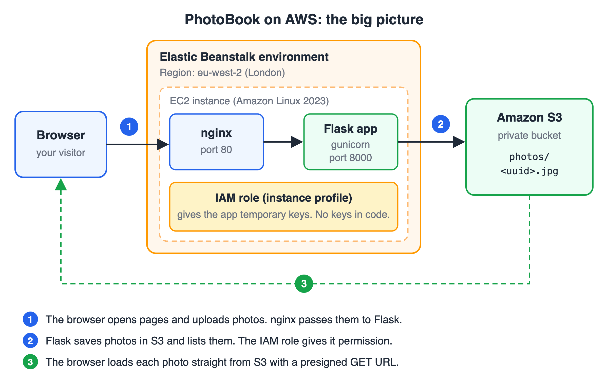
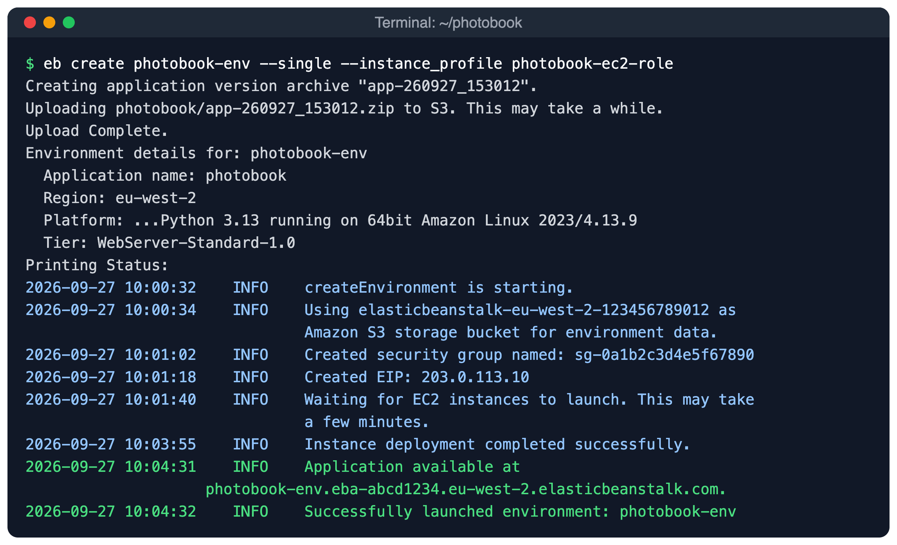
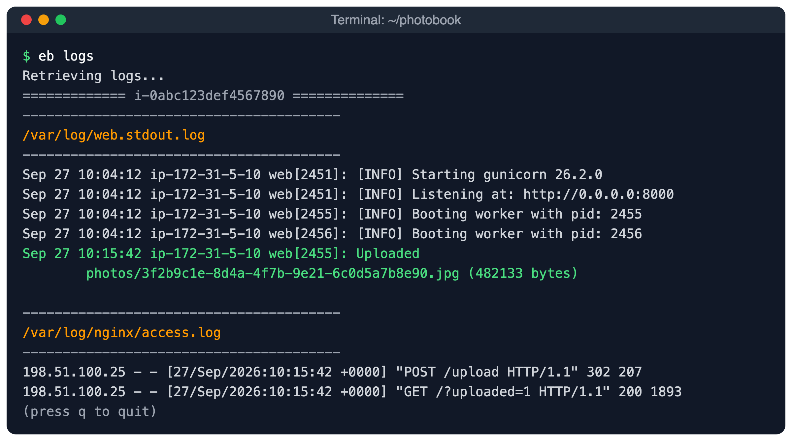

# How to Deploy a Flask App on AWS Elastic Beanstalk with Amazon S3 for File Uploads

*Build a small photo app, store the photos in a private S3 bucket, and run it on Elastic Beanstalk with no access keys anywhere.*

You have a Flask app that works on your laptop. Now you want it on the internet. Users should upload photos, and the photos should stay safe.

In this guide you will deploy a small app called **PhotoBook**. It has one page. The page shows the uploaded photos and has a form to upload a new one.

You will use two AWS services:

- **AWS Elastic Beanstalk** (EB) runs your Python code. You give it your code, and it creates the server, installs your packages and starts your app.
- **Amazon S3** (Simple Storage Service) stores the photos. S3 keeps files safely, and it has no disk size limit.

Why not save the photos on the server's disk? Elastic Beanstalk can replace a server at any time, for example when it is unhealthy. Files on the old disk are then lost. Also, with two servers, each one would have different files. With S3, every server uses the same bucket, and the files stay there.

Every command in this post uses the London region, `eu-west-2`. You can use any region. Just use the same one everywhere.

## What we are building


*The big picture: Elastic Beanstalk runs the app, S3 stores the photos, and an IAM role connects them.*

Here is how the parts work together:

- **Elastic Beanstalk** creates one **EC2 instance** (a virtual server). On it, **nginx** (a web server) receives requests and passes them to your Flask app. **gunicorn** (a production server for Python apps) runs Flask.
- The browser sends the photo to Flask. Flask checks the photo and then uploads it to S3 with boto3 (the AWS library for Python).
- The S3 **bucket** (a container for files in S3) is **private**. Nobody on the internet can read it directly.
- To show a photo, Flask creates a **presigned URL**. This is a temporary link with a signature in it. It opens one photo, and it stops working after one hour.
- The app gets its AWS permission from an **IAM role** (a set of permissions that a service can use) attached to the EC2 instance. So there are **no access keys** in your code or settings.


*Uploads go through Flask. Downloads go straight from S3 to the browser.*

## What you need

- An **AWS account**. Sign in as an IAM user or IAM Identity Center user with admin rights. This is the simplest way to learn. Do not use the root user for daily work.
- The **AWS CLI version 2** (the `aws` command), set up with `aws configure` or `aws configure sso`.
- **Python 3.13** on your computer. Python 3.10 or newer also works for local testing.
- **Git** (the EB CLI installer needs it).
- Basic Flask knowledge: routes, templates and forms.

## What it costs

Elastic Beanstalk itself has no extra charge. You pay for what it creates: the EC2 instance, its disk, a public IPv4 address, and a load balancer if you use one. You also pay for S3 storage, S3 requests and data sent out to the internet.

Prices change and depend on the region, so please check the official pricing pages for EC2, S3 and Elastic Beanstalk before you start.

**About the free tier:** in July 2025, AWS changed the free tier for new accounts. New accounts now get **credits** instead of 12 months of free services. You can choose a Free plan or a Paid plan. Read [aws.amazon.com/free](https://aws.amazon.com/free/) to see the current credits and which services each plan includes.

To keep costs low in this guide, you will create a **single-instance** environment (one server, no load balancer). At the end, you will delete everything.

## Step 1: Create a private S3 bucket

**Why:** the bucket holds all the photos. It must be private, so only your app can read and write it.


*A public bucket is easy but risky. A private bucket with presigned URLs gives you control.*

Bucket names are shared by all AWS accounts, so pick a unique name. This guide uses `photobook-uploads-yourname`. Replace `yourname` with your own name or a random word.

```bash
aws s3api create-bucket \
  --bucket photobook-uploads-yourname \
  --region eu-west-2 \
  --create-bucket-configuration LocationConstraint=eu-west-2
```

You should see something like this (newer CLI versions may show more fields):

```json
{
    "Location": "http://photobook-uploads-yourname.s3.amazonaws.com/"
}
```

New buckets have **Block Public Access** turned on by default. This setting stops anyone from making the bucket or its files public by mistake. Check it:

```bash
aws s3api get-public-access-block --bucket photobook-uploads-yourname
```

```json
{
    "PublicAccessBlockConfiguration": {
        "BlockPublicAcls": true,
        "IgnorePublicAcls": true,
        "BlockPublicPolicy": true,
        "RestrictPublicBuckets": true
    }
}
```

All four values must be `true`. Leave them like that.

**Prefer the console?** Open the S3 console, choose your region at the top, then choose **General purpose buckets → Create bucket**. Enter the bucket name. Keep **Object Ownership** on "ACLs disabled", keep all four boxes under **Block Public Access settings for this bucket** ticked, and choose **Create bucket**. If the console asks about the bucket namespace, the default is fine.

The Create bucket page. Keep all four Block Public Access boxes ticked.

## Step 2: Create an IAM role for the EC2 instance

**Why:** your app needs permission to use the bucket. On AWS, the safe way is an **IAM role**. Elastic Beanstalk attaches the role to the EC2 instance through an **instance profile** (a small wrapper that lets an EC2 instance use a role). boto3 then gets short-lived keys from the instance by itself. AWS changes these keys often, and they never appear in your code.


*The role gives the app only the permissions it needs, and no long-lived keys exist.*

Elastic Beanstalk used to create a default instance profile for you. It does not do this any more for new accounts, so you create one yourself.

First, make a folder for the project and a folder for the setup files:

```bash
mkdir -p photobook/aws-setup
cd photobook
```

Create `aws-setup/trust-policy.json`. A **trust policy** says who can use the role. Here, only EC2 can:

```json
{
  "Version": "2012-10-17",
  "Statement": [
    {
      "Effect": "Allow",
      "Principal": { "Service": "ec2.amazonaws.com" },
      "Action": "sts:AssumeRole"
    }
  ]
}
```

Create `aws-setup/photobook-s3-policy.json`. This **permission policy** says what the role can do. Put your bucket name in both places:

```json
{
  "Version": "2012-10-17",
  "Statement": [
    {
      "Sid": "ListPhotos",
      "Effect": "Allow",
      "Action": "s3:ListBucket",
      "Resource": "arn:aws:s3:::photobook-uploads-yourname",
      "Condition": { "StringLike": { "s3:prefix": ["photos/*"] } }
    },
    {
      "Sid": "ReadWritePhotos",
      "Effect": "Allow",
      "Action": ["s3:GetObject", "s3:PutObject"],
      "Resource": "arn:aws:s3:::photobook-uploads-yourname/photos/*"
    }
  ]
}
```

This policy follows **least privilege** (give only the permissions you need):

- `s3:ListBucket` lets the app list files, but only under `photos/`.
- `s3:PutObject` lets the app upload files under `photos/`.
- `s3:GetObject` lets the app read files under `photos/`. Presigned links need this, because a link can only do what its signer can do.
- There is no delete permission, and no access to other buckets.

Now create the role, attach the policies, and create the instance profile:

```bash
# 1. Create the role that EC2 can use
aws iam create-role --role-name photobook-ec2-role \
  --assume-role-policy-document file://aws-setup/trust-policy.json

# 2. Let Elastic Beanstalk run on the instance (logs, health)
aws iam attach-role-policy --role-name photobook-ec2-role \
  --policy-arn arn:aws:iam::aws:policy/AWSElasticBeanstalkWebTier

# 3. Add your S3 policy to the role
aws iam put-role-policy --role-name photobook-ec2-role \
  --policy-name photobook-s3-access \
  --policy-document file://aws-setup/photobook-s3-policy.json

# 4. Create the instance profile and put the role in it
aws iam create-instance-profile --instance-profile-name photobook-ec2-role
aws iam add-role-to-instance-profile \
  --instance-profile-name photobook-ec2-role --role-name photobook-ec2-role
```

Check that the instance profile holds the role:

```bash
aws iam get-instance-profile --instance-profile-name photobook-ec2-role \
  --query "InstanceProfile.Roles[0].RoleName"
```

```text
"photobook-ec2-role"
```

**Prefer the console?** Open **IAM → Roles → Create role**. For **Trusted entity type**, choose **AWS service**. For **Use case**, choose **EC2**. Attach `AWSElasticBeanstalkWebTier`, name the role `photobook-ec2-role` and create it. When you create an EC2 role in the console, IAM also creates an instance profile with the same name. Then open the role, choose **Add permissions → Create inline policy**, paste the S3 policy in the JSON editor and name it `photobook-s3-access`.

Your role: EC2 is the trusted entity, and two policies are attached.

## Step 3: Build the app

**Why:** now you write the Flask app. It reads its settings from **environment variables** (settings that live outside the code), so the same code works on your laptop and on AWS.

Your project will look like this:

```text
photobook/
├── app.py
├── templates/
│   └── index.html
├── requirements.txt
├── Procfile
├── .platform/
│   └── nginx/
│       └── conf.d/
│           └── upload_size.conf
├── .ebignore
├── aws-setup/
│   ├── trust-policy.json
│   └── photobook-s3-policy.json
├── test_app.py            (optional)
└── requirements-dev.txt   (optional)
```

Here is `app.py`:

```python
import os
import uuid

import boto3
from botocore.config import Config
from flask import Flask, redirect, render_template, request, url_for

# Settings come from environment variables. No secrets in the code.
BUCKET = os.environ.get("S3_BUCKET", "")
REGION = os.environ.get("AWS_REGION", "eu-west-2")

MAX_PHOTO_BYTES = 5 * 1024 * 1024  # 5 MB
LINK_SECONDS = 3600  # presigned links work for 1 hour

# The first bytes of a file tell us its real type.
# We map each allowed type to its file extension.
ALLOWED_TYPES = {
    "image/jpeg": "jpg",
    "image/png": "png",
    "image/webp": "webp",
}

app = Flask(__name__)
# Flask stops any request body bigger than this with "413".
# It is a bit more than 5 MB, because the form adds some extra bytes.
app.config["MAX_CONTENT_LENGTH"] = MAX_PHOTO_BYTES + 512 * 1024

# boto3 finds credentials by itself:
# on your laptop from your AWS profile, on Elastic Beanstalk from the instance role.
s3 = boto3.client(
    "s3",
    region_name=REGION,
    endpoint_url=f"https://s3.{REGION}.amazonaws.com",
    config=Config(signature_version="s3v4", s3={"addressing_style": "virtual"}),
)


def detect_type(head):
    """Return the image type from the first bytes of the file, or None."""
    if head.startswith(b"\xff\xd8\xff"):
        return "image/jpeg"
    if head.startswith(b"\x89PNG\r\n\x1a\n"):
        return "image/png"
    if head[:4] == b"RIFF" and head[8:12] == b"WEBP":
        return "image/webp"
    return None


def list_photos():
    """Return the newest photos, each with a temporary link."""
    response = s3.list_objects_v2(Bucket=BUCKET, Prefix="photos/", MaxKeys=1000)
    items = sorted(
        response.get("Contents", []),
        key=lambda item: item["LastModified"],
        reverse=True,
    )
    photos = []
    for item in items[:50]:
        link = s3.generate_presigned_url(
            "get_object",
            Params={"Bucket": BUCKET, "Key": item["Key"]},
            ExpiresIn=LINK_SECONDS,
        )
        photos.append({"key": item["Key"], "url": link})
    return photos


def show_page(error=None, status=200):
    if not BUCKET:
        return render_template("index.html", setup_needed=True, photos=[]), status
    uploaded = request.args.get("uploaded") == "1"
    return render_template(
        "index.html",
        photos=list_photos(),
        error=error,
        uploaded=uploaded,
    ), status


@app.get("/")
def index():
    return show_page()


@app.post("/upload")
def upload():
    if not BUCKET:
        return show_page()

    photo = request.files.get("photo")
    if photo is None or photo.filename == "":
        return show_page("Please choose a photo first.", 400)

    # Check the size without reading the whole file into memory.
    photo.stream.seek(0, os.SEEK_END)
    size = photo.stream.tell()
    photo.stream.seek(0)
    if size > MAX_PHOTO_BYTES:
        return show_page("The photo is too big. The limit is 5 MB.", 400)

    # Check the real type from the first 12 bytes. Do not trust the file name.
    content_type = detect_type(photo.stream.read(12))
    photo.stream.seek(0)
    if content_type is None:
        return show_page("Only JPEG, PNG and WebP photos are allowed.", 400)

    # A random, unique name. The user's file name is never used as the key.
    key = f"photos/{uuid.uuid4()}.{ALLOWED_TYPES[content_type]}"
    s3.upload_fileobj(
        photo.stream,
        BUCKET,
        key,
        ExtraArgs={"ContentType": content_type},
    )
    # print() goes to the app log (web.stdout.log on Elastic Beanstalk).
    print(f"Uploaded {key} ({size} bytes)", flush=True)
    return redirect(url_for("index", uploaded="1"))


@app.errorhandler(413)
def too_large(error):
    return show_page("The photo is too big. The limit is 5 MB.", 413)


if __name__ == "__main__":
    app.run(debug=True)
```

A few important points about this code:

- **The boto3 client.** It uses the regional endpoint, Signature Version 4 and "virtual" addressing. With these settings, presigned URLs work in every region.
- **No credentials in the code.** boto3 looks for credentials by itself. On your laptop, it uses your AWS CLI profile. On Elastic Beanstalk, it uses the instance role.
- **Checking the file.** The app does not trust the file name or the browser. It reads the first bytes of the file (the "magic bytes") to find the real type. Only JPEG, PNG and WebP pass.
- **Two size checks.** `MAX_CONTENT_LENGTH` stops very large requests early with a `413` error. The app also checks that the photo itself is 5 MB or less.
- **A random key.** The **key** is the file's full name in the bucket, like `photos/3f2b9c1e-....jpg`. Random keys never clash, and nobody can guess them.
- **`upload_fileobj`** streams the file to S3 and sets the right `ContentType`, so browsers show the photo instead of downloading it.
- **Presigned GET URLs** last 3,600 seconds (one hour). Links made with role credentials can stop earlier, when those temporary credentials expire. That is fine here, because the page makes fresh links every time it loads.

Now create `templates/index.html`:

```html
<!doctype html>
<html lang="en">
<head>
  <meta charset="utf-8">
  <meta name="viewport" content="width=device-width, initial-scale=1">
  <title>PhotoBook</title>
  <style>
    body { font-family: system-ui, sans-serif; max-width: 860px; margin: 2rem auto; padding: 0 1rem; color: #1f2937; }
    form { display: flex; gap: .5rem; flex-wrap: wrap; align-items: center; margin-bottom: 1rem; }
    .msg { padding: .6rem .8rem; border-radius: 6px; }
    .ok { background: #dcfce7; }
    .err { background: #fee2e2; }
    .grid { display: grid; grid-template-columns: repeat(auto-fill, minmax(160px, 1fr)); gap: .75rem; }
    .grid img { width: 100%; height: 160px; object-fit: cover; border-radius: 6px; }
  </style>
</head>
<body>
  <h1>PhotoBook</h1>

  
    <p class="msg err">Setup needed: set the <code>S3_BUCKET</code> environment variable.</p>
  
    <form action="{{ url_for('upload') }}" method="post" enctype="multipart/form-data">
      <input type="file" name="photo" accept="image/jpeg,image/png,image/webp" required>
      <button type="submit">Upload</button>
      <small>JPEG, PNG or WebP. Max 5 MB.</small>
    </form>

    <p class="msg ok">Photo uploaded.</p>
    <p class="msg err">{{ error }}</p>

    <div class="grid">
      
        <a href="{{ photo.url }}"></a>
      
        <p>No photos yet. Upload the first one.</p>
      
    </div>
  
</body>
</html>
```

Create `requirements.txt`. These are the current versions at the time of writing:

```text
Flask==3.1.3
boto3==1.43.103
gunicorn==26.2.0
```

## Step 4: Test the app on your computer

**Why:** it is much faster to fix a bug on your laptop than on a server.

Your AWS CLI user needs access to the bucket. An admin user already has it. Check who you are:

```bash
aws sts get-caller-identity
```

```json
{
    "UserId": "AIDAEXAMPLEUSERID1234",
    "Account": "123456789012",
    "Arn": "arn:aws:iam::123456789012:user/your-user"
}
```

Create a virtual environment, install the packages and start the app:

```bash
python3.13 -m venv .venv
source .venv/bin/activate          # On Windows: .venv\Scripts\activate
pip install -r requirements.txt

export S3_BUCKET=photobook-uploads-yourname
export AWS_REGION=eu-west-2
flask --app app run --debug --port 8000
```

On Windows PowerShell, use `$env:S3_BUCKET="photobook-uploads-yourname"` instead of `export`. We use port 8000 because on macOS, port 5000 is often used by AirPlay.

```text
 * Serving Flask app 'app'
 * Debug mode: on
 * Running on http://127.0.0.1:8000
Press CTRL+C to quit
```

Open `http://127.0.0.1:8000` and upload a photo. You should see "Photo uploaded." and your thumbnail. Try a `.gif` or a text file too. You should see "Only JPEG, PNG and WebP photos are allowed."

You can also list the bucket from the terminal:

```bash
aws s3 ls s3://photobook-uploads-yourname/photos/
```

```text
2026-09-27 15:20:41     482133 3f2b9c1e-8d4a-4f7b-9e21-6c0d5a7b8e90.jpg
```

**Optional: automatic tests.** The code folder has a `test_app.py` file. It uses **moto** (a library that fakes AWS on your computer), so it needs no AWS account. It checks the home page, valid and invalid uploads, the 5 MB limit, the presigned links, and that gunicorn can load the app.

```bash
pip install -r requirements-dev.txt
python -m unittest -v test_app.py
```

```text
Ran 8 tests in 7.9s

OK
```

## Step 5: Install the EB CLI and run eb init

**Why:** the **EB CLI** (the `eb` command) creates and updates your Elastic Beanstalk environment from the terminal.

AWS recommends the installer script. It installs the EB CLI in its own virtual environment, so it does not break your other Python packages:

```bash
git clone https://github.com/aws/aws-elastic-beanstalk-cli-setup.git
python ./aws-elastic-beanstalk-cli-setup/scripts/ebcli_installer.py
```

At the end, the script prints a command to add `eb` to your `PATH`. Run it, then open a new terminal and check:

```bash
eb --version
```

```text
EB CLI 3.27.3 (Python 3.13.x)
```

Your version number may be different. On macOS, `brew install awsebcli` also works.

Now go to your project folder and create the EB **application** (a folder in Elastic Beanstalk for your app's versions and environments):

```bash
eb init -p python-3.13 photobook --region eu-west-2
```

```text
Application photobook has been created.
```

This command creates a `.elasticbeanstalk/config.yml` file. It remembers the app name, the region and the platform: **Python 3.13 running on 64bit Amazon Linux 2023**.

## Step 6: Tell Elastic Beanstalk how to start the app and allow bigger uploads

**Why:** Elastic Beanstalk looks for a file named `application.py` with an object named `application`. Our file is `app.py` and our object is `app`. A **Procfile** tells Elastic Beanstalk the exact start command. Create a file named `Procfile` (no extension):

```text
web: gunicorn --bind :8000 --workers 2 app:app
```

Elastic Beanstalk sends traffic from nginx to port 8000, so gunicorn must listen there.

Next, the upload size. **nginx allows only 1 MB per request by default.** A normal phone photo is 2 to 5 MB, so nginx would block it with `413 Request Entity Too Large` before Flask ever sees it.


*nginx must allow a bit more than your app's limit, so Flask can show a friendly message.*

Create the file `.platform/nginx/conf.d/upload_size.conf`:

```text
# Allow uploads up to 10 MB. The nginx default is 1 MB.
# Flask itself still rejects photos over 5 MB with a clear message.
client_max_body_size 10M;
```

Elastic Beanstalk adds every `.conf` file in `.platform/nginx/conf.d/` to its nginx settings. The file name must end with `.conf`.

Last, create `.ebignore`. It lists the files that should **not** be uploaded to Elastic Beanstalk:

```text
.venv/
__pycache__/
.pytest_cache/
*.pyc
test_app.py
requirements-dev.txt
aws-setup/
```

Note: when an `.ebignore` file exists, the EB CLI uploads all other files in the folder, even files that you have not committed to Git.

## Step 7: Create the environment with eb create

**Why:** an **environment** is the running copy of your app: the server, the security group, the web address and more. One command creates all of it.

```bash
eb create photobook-env --single --instance_profile photobook-ec2-role
```

- `photobook-env` is the environment name.
- `--single` creates one EC2 instance with no load balancer. This is cheaper and good for learning and testing. For real production traffic, leave it out to get a load balancer.
- `--instance_profile photobook-ec2-role` attaches the role from Step 2. This is how the app gets S3 permission.

If your account has no Elastic Beanstalk **service role** yet (a role that Elastic Beanstalk itself uses to manage your resources), the EB CLI creates `aws-elasticbeanstalk-service-role` for you.

This takes about five minutes. You should see output like this:


*A successful eb create. The last lines show your app's web address.*

```text
Creating application version archive "app-260927_153012".
Uploading photobook/app-260927_153012.zip to S3. This may take a while.
Upload Complete.
Environment details for: photobook-env
  Application name: photobook
  Region: eu-west-2
  Deployed Version: app-260927_153012
  Environment ID: e-abcd1234ef
  Platform: arn:aws:elasticbeanstalk:eu-west-2::platform/Python 3.13 running on 64bit Amazon Linux 2023/4.13.9
  Tier: WebServer-Standard-1.0
  CNAME: UNKNOWN
  Updated: 2026-09-27 10:00:31.123000+00:00
Printing Status:
2026-09-27 10:00:32    INFO    createEnvironment is starting.
...
2026-09-27 10:04:31    INFO    Application available at photobook-env.eba-abcd1234.eu-west-2.elasticbeanstalk.com.
2026-09-27 10:04:32    INFO    Successfully launched environment: photobook-env
```

The environment is running, but the app does not know your bucket name yet. If you open it now, you will see "Setup needed: set the S3_BUCKET environment variable." That is expected.

## Step 8: Set the environment variables with eb setenv

**Why:** the bucket name and region are settings, not code. Elastic Beanstalk calls them **environment properties** and gives them to your app as environment variables.

```bash
eb setenv S3_BUCKET=photobook-uploads-yourname AWS_REGION=eu-west-2
```

```text
2026-09-27 10:06:02    INFO    Environment update is starting.
2026-09-27 10:06:08    INFO    Updating environment photobook-env's configuration settings.
2026-09-27 10:06:51    INFO    Successfully deployed new configuration to environment.
2026-09-27 10:06:52    INFO    Environment update completed successfully.
```

Notice that there are no AWS keys in this list. The instance role handles that. You can see all properties with `eb printenv`.

## Step 9: Open the app, test it and deploy changes

Check the environment first:

```bash
eb status
```

```text
Environment details for: photobook-env
  Application name: photobook
  Region: eu-west-2
  ...
  Status: Ready
  Health: Green
```

**Green** means the app answers requests. Now open it in your browser:

```bash
eb open
```

The environment page in the Elastic Beanstalk console. Health should be green.

Upload a photo, just like you did on your laptop. You should see "Photo uploaded." and the thumbnail.

PhotoBook running on AWS. The photos come straight from your private bucket.

Right-click a photo and open it in a new tab. Look at the address. It contains `X-Amz-Signature` and `X-Amz-Expires=3600`. That is the presigned URL. Now try to open the photo without the part after `?`. S3 answers with `AccessDenied`, because the bucket is private. Good.

**To deploy a change**, edit your code and run:

```bash
eb deploy
```

```text
Creating application version archive "app-260927_161045".
Uploading photobook/app-260927_161045.zip to S3. This may take a while.
Upload Complete.
2026-09-27 10:40:50    INFO    Environment update is starting.
2026-09-27 10:40:55    INFO    Deploying new version to instance(s).
2026-09-27 10:41:10    INFO    Instance deployment completed successfully.
2026-09-27 10:41:16    INFO    New application version was deployed to running EC2 instances.
2026-09-27 10:41:16    INFO    Environment update completed successfully.
```

## Step 10: Read the logs

**Why:** when something goes wrong on the server, the logs tell you what happened.

```bash
eb logs
```

This shows the last lines of the important log files. Press `q` to quit. Your app's output is in `/var/log/web.stdout.log`. The `print()` line in `upload()` appears there for each upload.


*eb logs shows gunicorn starting, your upload message, and the nginx requests.*

Useful options:

- `eb logs --all` downloads the full log files into `.elasticbeanstalk/logs/`.
- `eb logs --stream` keeps showing new lines. It works when CloudWatch log streaming is on. Turn it on with `eb logs --cloudwatch-logs enable`.

## Step 11 (optional): HTTPS and a custom domain

Your app now runs on `http://`, not `https://`. For a real site you need HTTPS. The simplest way on Elastic Beanstalk is a **load-balanced** environment:

1. Create the environment without `--single`, so it gets an Application Load Balancer.
2. Request a free public certificate in **AWS Certificate Manager (ACM)** for your domain, in the **same region** as the environment (`eu-west-2`).
3. Add an HTTPS listener to the load balancer. You can do this in the console under the environment's **Configuration**, or with a file like `.ebextensions/https.config`:

```yaml
option_settings:
  aws:elbv2:listener:443:
    ListenerEnabled: 'true'
    Protocol: HTTPS
    SSLCertificateArns: arn:aws:acm:eu-west-2:123456789012:certificate/your-certificate-id
```

4. Point your domain at the environment. For `www.example.com`, add a CNAME record to `photobook-env.eba-abcd1234.eu-west-2.elasticbeanstalk.com`. For the bare domain (`example.com`), use a Route 53 alias record.

If you delete the environment later, also delete the DNS record. Otherwise it points to an address that someone else could take.

## Step 12: Clean up

**Why:** a running EC2 instance costs money every hour, even with no visitors. Delete everything when you finish.

Delete the Elastic Beanstalk environment and application. The EB CLI asks you to confirm first:

```bash
eb terminate --all
```

Empty and delete your photo bucket:

```bash
aws s3 rm s3://photobook-uploads-yourname --recursive
aws s3api delete-bucket --bucket photobook-uploads-yourname
```

Delete the IAM role and instance profile:

```bash
aws iam remove-role-from-instance-profile \
  --instance-profile-name photobook-ec2-role --role-name photobook-ec2-role
aws iam delete-instance-profile --instance-profile-name photobook-ec2-role
aws iam detach-role-policy --role-name photobook-ec2-role \
  --policy-arn arn:aws:iam::aws:policy/AWSElasticBeanstalkWebTier
aws iam delete-role-policy --role-name photobook-ec2-role --policy-name photobook-s3-access
aws iam delete-role --role-name photobook-ec2-role
```

Elastic Beanstalk also created a bucket named like `elasticbeanstalk-eu-west-2-123456789012`. It holds your uploaded code versions and is not deleted with the environment. It is small, but you can delete it too. First remove its bucket policy in the S3 console, then empty and delete it.

## Troubleshooting

- **You see an nginx page "413 Request Entity Too Large".**
  Cause: nginx did not get your upload setting, so it still uses 1 MB.
  Fix: check the path `.platform/nginx/conf.d/upload_size.conf`, check that the name ends in `.conf`, and check that `.ebignore` does not exclude `.platform`. Then run `eb deploy`. (If you see the PhotoBook page with "The limit is 5 MB", that is the app's own limit working correctly.)

- **The page shows an error, and `eb logs` shows `AccessDenied` for `PutObject` or `ListObjectsV2`.**
  Cause: the role's policy does not match your bucket, or the environment uses a different instance profile.
  Fix: make sure the bucket name in `photobook-s3-policy.json` is exactly your bucket name, in both `Resource` lines. In the console, open the environment's **Configuration** and check the EC2 instance profile under service access. It must be `photobook-ec2-role`.

- **`botocore.exceptions.NoCredentialsError: Unable to locate credentials`.**
  Cause on your laptop: the AWS CLI is not set up. Run `aws configure` (or `aws sso login`) and check with `aws sts get-caller-identity`. If you use a named profile, set `AWS_PROFILE`.
  Cause on Elastic Beanstalk: the environment has no instance profile. Create it again with `--instance_profile photobook-ec2-role`.

- **`502 Bad Gateway` from nginx, and health is Red or Degraded.**
  Cause: gunicorn did not start, so nginx has nothing to talk to on port 8000.
  Fix: run `eb logs` and read `web.stdout.log`. Common reasons are a wrong `Procfile` (it must say `app:app`), `gunicorn` missing from `requirements.txt`, or a Python error when the app starts.

- **Thumbnails are broken, and opening one shows `AccessDenied` or `Request has expired`.**
  Cause: the link expired, or the role cannot run `s3:GetObject`.
  Fix: reload the page to get fresh links. If it still fails, check that the policy allows `s3:GetObject` on `photos/*`.

- **`SignatureDoesNotMatch`, `AuthorizationHeaderMalformed` or `PermanentRedirect` errors.**
  Cause: `AWS_REGION` is not the bucket's region, or your computer's clock is wrong.
  Fix: set `AWS_REGION` to the region you used in Step 1 (`eu-west-2`) with `eb setenv`, and sync your clock.

- **`eb create` fails with an error about the instance profile or the service role.**
  Cause: the role from Step 2 does not exist yet, or IAM has not finished saving it.
  Fix: check it with `aws iam get-instance-profile`, wait a minute and try again. If the service role is missing, run `eb create` with no arguments once. It asks questions and can create the role for you.

## Security checklist

- Keep **Block Public Access** on for the photo bucket.
- Give the app role **only** the S3 actions it needs, only on `photos/*`.
- Never put access keys in code, in `.env` files that you commit, or in `eb setenv`. Use the instance role.
- Check the **real file type** (magic bytes) and the **size** on the server. Never trust the file name.
- Use **random keys** for uploaded files. Never use the user's file name as the key.
- Keep presigned links **short-lived** (one hour or less here).
- Use **HTTPS** before real users log in or upload private photos.
- Keep the platform up to date. Elastic Beanstalk can apply **managed platform updates** for you.

## Next steps

You now have a real Flask app on AWS. It stores files in a private S3 bucket and has no secrets in the code. Here are good next steps:

- Switch to a load-balanced environment with HTTPS (Step 11) for production.
- Add an **AWS Lambda** function that makes small thumbnails when a new photo lands in S3.
- Store photo details (owner, title, date) in a database such as Amazon RDS or DynamoDB.
- Deploy automatically from GitHub Actions. Use OpenID Connect (OIDC) so that GitHub also needs no stored AWS keys.

The main ideas work for any app, not just Flask: keep files in S3, keep the bucket private, give the server a role instead of keys, and make short-lived links to share files. Happy deploying!
