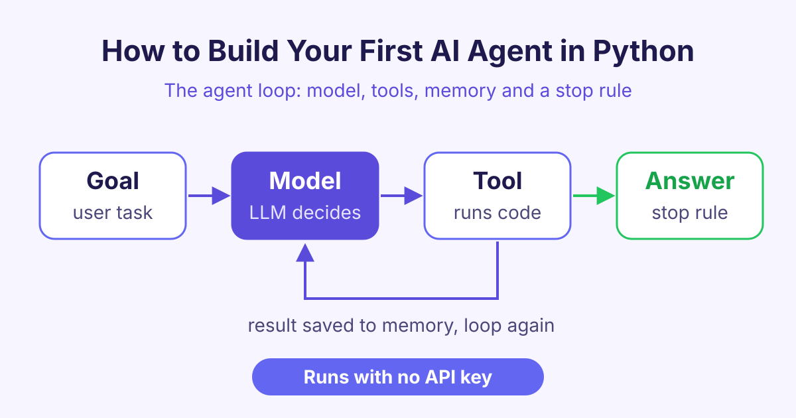

# How to Build Your First AI Agent in Python (Step by Step)

*Learn how to build an AI agent in Python: the simple loop of model, tools, memory and a stop rule, plus a small example you can run with no API key.*

To build an AI agent, you put a language model inside a loop: the model picks a tool, your code runs the tool, the result goes back to the model, and the loop stops when the model gives a final answer. That is the whole idea of how to build an AI agent, and you can write it in about 20 lines of Python.



## What is an AI agent?

An **AI agent** is a program that uses an AI model to decide what to do next, step by step, until a task is done.

A normal chatbot reads your message and writes one reply. An agent can look something up, run a calculation or read a file, and then use what it found to decide the next step.

Here is a simple way to see the difference:

| | Chatbot | AI agent |
|---|---|---|
| What it does | Writes one reply | Takes several steps |
| Can use tools | No | Yes |
| Remembers steps | Only the chat | Every step and result |
| When it stops | After one reply | When the goal is done |

## The four parts of every AI agent

Every agent, small or large, has the same four parts.

### 1. The model

The **model** is the brain. It is usually a large language model (LLM), a program trained on a lot of text that can read and write language. In an agent, the model does not do the work itself. It decides which tool to use.

### 2. Tools

**Tools** are normal functions in your code. A tool might add numbers, search a database, send an email or get the weather. You tell the model the name of each tool and what it needs. The model then asks for a tool by name, and your code runs it.

### 3. Memory

**Memory** is the list of everything that has happened so far: the user's goal, each tool call and each result. You send this list to the model on every step, so it knows what it has already done.

### 4. A stop rule

The **stop rule** tells the loop when to end. There are usually two:

- The model gives a final answer instead of asking for a tool.
- The loop reaches a maximum number of steps. This stops the agent from running forever if something goes wrong.

## How does the agent loop work?

The agent loop is a simple cycle. It repeats these steps:

1. Send the memory (goal plus past steps) to the model.
2. The model replies with either a tool call or a final answer.
3. If it is a final answer, stop and return it.
4. If it is a tool call, run the tool in your code.
5. Add the result to memory and go back to step 1.

The model never runs code on its own. Your program stays in control: it decides which tools exist, runs them and checks the results.

## How to build an AI agent in Python with no API key

Real agents call a model from a company such as OpenAI, Google or Anthropic. That needs an API key (a secret password for the service). To learn the loop first, we can use a **fake model**: a small function that pretends to be the model and gives fixed replies.

Save this as `agent.py` and run `python3 agent.py`. It needs only plain Python 3.

```python
# A tiny AI agent with a fake model, so no API key is needed
def fake_model(messages):
    last = messages[-1]
    if last["role"] == "user":
        return {"tool": "add", "args": {"a": 12, "b": 30}}
    return {"answer": f"The total is {last['content']}."}

TOOLS = {"add": lambda a, b: a + b}

def run_agent(goal, max_steps=5):
    messages = [{"role": "user", "content": goal}]  # memory
    for step in range(max_steps):                    # stop rule 1
        reply = fake_model(messages)
        if "answer" in reply:                        # stop rule 2
            return reply["answer"]
        result = TOOLS[reply["tool"]](**reply["args"])
        print(f"Step {step + 1}: called {reply['tool']} -> {result}")
        messages.append({"role": "tool", "content": result})
    return "Stopped: too many steps."

print(run_agent("What is 12 + 30?"))
```

When you run it, it prints `Step 1: called add -> 42` and then `The total is 42.`

### What each part of the code does

- `fake_model` plays the role of the model. If the last message is from the user, it asks for the `add` tool. If the last message is a tool result, it gives the final answer.
- `TOOLS` is a dictionary (a list of name and value pairs) that maps tool names to real Python functions.
- `messages` is the memory. Each step adds a new entry.
- `max_steps` and the `"answer"` check are the two stop rules.

## How do you turn this into a real AI agent?

To make this a real AI agent in Python, you only change one part: replace `fake_model` with a call to a real model. Most model services support **tool calling** (also called function calling). You send each tool's name, a short description and its inputs. The model replies with a tool name and inputs, like our fake model does.

The rest of your loop stays the same. A few good habits help:

- **Describe tools clearly.** The model picks tools based on their names and descriptions.
- **Check inputs.** Never trust tool inputs blindly, especially for tools that delete files or spend money.
- **Keep the step limit.** It saves time and cost when the model gets stuck.

You can learn all of this step by step in our [Building AI Agents](/courses/building-ai-agents) course.

## How do agents share tools with MCP?

As you add more tools, you may want to reuse them in different apps. The **Model Context Protocol (MCP)** is an open standard for this. An MCP server offers a set of tools, and any agent or app that supports MCP can connect to it and use them.

You write a tool once, and many AI apps can use it. To build your own, see our [Building MCP Servers](/courses/building-mcp-servers) course.

## Frequently asked questions

### Do I need an API key to build an AI agent?

Not to learn the idea. You can use a fake model function, like the one in this post, to practise the loop. For a real agent that understands any question, you need access to a real model, which usually means an API key.

### What is the difference between an AI agent and a chatbot?

A chatbot writes one reply to each message. An AI agent can take several steps, use tools and check results before it gives a final answer. Many agents use a chatbot-style model as their brain.

### Which programming language is best for AI agents?

Python is the most common choice because it is easy to read and most AI libraries support it. You can also use JavaScript or other languages, since the loop is the same everywhere.

### Why does an AI agent need a stop rule?

Without a stop rule, a confused agent could call tools forever. A step limit keeps it safe, fast and cheap.

## Start learning

Now you know the four parts of an agent and how the loop works. Build agents with real models, step by step, in our [Building AI Agents](/courses/building-ai-agents) course.
