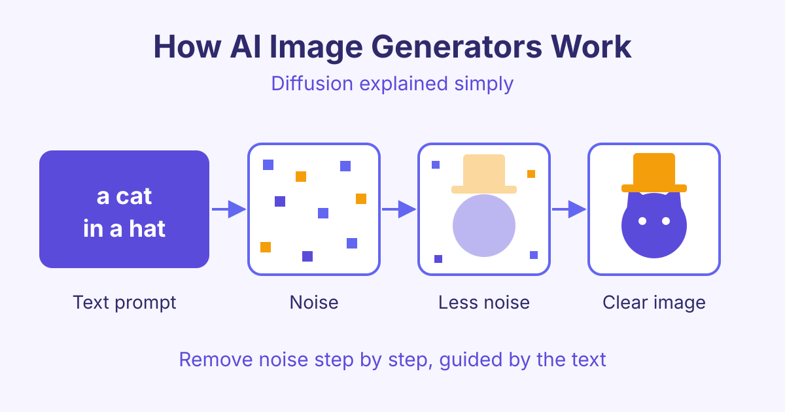

# How AI Image Generators Work (Diffusion Explained Simply)

*Learn how AI image generators work in simple steps: text encoders, noise, denoising and latent space, plus prompt tips and the ethics of text-to-image AI.*

Here is how AI image generators work: they turn your words into numbers, start from a picture of pure random noise, and then remove that noise step by step until an image that matches your words appears. This method is called diffusion, and it is behind most popular text-to-image AI tools today.

## What is a diffusion model?

A diffusion model is a type of AI that learns to make images by learning to remove noise. Noise here means random coloured dots, like the static on an old TV.

During training, the model sees millions of images with captions. For each image, the training process adds a little noise, then more, until the picture is just static. The model's job is to guess the noise that was added at each step. If it can guess the noise, it can take it away.

After training, the model can run this in reverse. It starts with pure noise and removes a little at a time. Each step makes the picture slightly clearer.

## How AI image generators work, step by step

When you type a prompt, several parts work together:

1. **You write a prompt**, for example "a cat in a hat".
2. **A text encoder reads it.** A text encoder is a model that turns words into a list of numbers that captures their meaning. Similar ideas get similar numbers.
3. **The generator starts from noise.** It creates a random noisy image. A different random start gives a different picture, which is why the same prompt can give many results.
4. **It denoises step by step.** At each step, the model predicts which part of the picture is noise and removes some of it. The text numbers guide it, so the shapes slowly become a cat and a hat.
5. **You get the final image.** After many steps (often 20 to 50), the noise is gone and a clear image is left.

The text guides every step. That is how the model knows to make a cat and not a dog.

## What is latent space?

Working on a full-size image at every step needs a lot of computer power. Many image generators save time by working in latent space.

Latent space is a smaller, compressed version of the image. Think of it like a short summary that still keeps the important details, such as shapes, colours and layout. The model does all the denoising on this small version. At the end, a decoder (a model that rebuilds the full picture) turns the summary back into a full image.

This idea is used in latent diffusion models, such as Stable Diffusion. It is a big reason these tools can run quickly, and some can even run on a home computer with a good graphics card.

## Why AI used to get hands and text wrong

Early image generators were famous for strange hands with six fingers and signs full of nonsense letters. There are a few simple reasons:

- **Hands are hard.** In photos, hands are often small, blurred or partly hidden. Fingers can bend in many ways. The model saw fewer clear examples, so it learned them less well.
- **Text needs exact shapes.** A model learns what letters look like in general, not how to spell. A small mistake in one letter is easy to notice.
- **Working in a small latent space** can lose fine details, like thin fingers or small letters.

Newer models have improved a lot, thanks to more training data, better text encoders and larger models. Mistakes can still happen, so always zoom in and check.

## Prompt tips for better AI images

A clear prompt gives the model better guidance. Try this simple structure:

| Part | Example |
|---|---|
| Subject | a ginger cat wearing a red top hat |
| Setting | sitting on a wooden table in a cosy kitchen |
| Style | watercolour illustration |
| Light and mood | soft morning light, warm and calm |
| Framing | close-up, centred |

More tips:

- Be specific. "A red top hat" works better than "a hat".
- Put the most important idea first.
- Change one thing at a time, so you know what made the difference.
- Use a negative prompt (a list of things you do not want, like "blurry") if your tool supports it.
- Generate a few versions and pick the best.

To use these tips in real design work, such as posters and product images, see the [AI Images and Design course](/courses/ai-images-design).

## Ethics of AI image generation

AI images are powerful, so they need care.

- **Copyright:** Many models were trained on images from the internet, and laws on this are still being argued in courts in several countries. Avoid copying a living artist's style or using famous characters and logos in work you sell.
- **Deepfakes:** A deepfake is a fake image or video that shows a real person doing something they never did. Never make images of real people without their permission, and never use AI images to trick people.
- **Labelling:** Tell people when an image was made with AI. Some tools add a hidden watermark or content credentials (a record of how the image was made). Do not remove them.
- **Bias:** Models can repeat stereotypes from their training data. Check your results and adjust your prompt to be fair.

## Frequently asked questions

### Do AI image generators copy existing pictures?

Usually no. They learn patterns from many images and create new combinations from noise. However, a model can sometimes produce something very close to a well-known image, especially if that image appeared many times in its training data.

### Why do I get a different image with the same prompt?

Each image starts from a different random noise pattern, called a seed. A different seed leads to a different picture. Many tools let you fix the seed so you can get the same result again.

### Is a diffusion model the same as ChatGPT?

No. ChatGPT is mainly a large language model that predicts the next piece of text. A diffusion model creates images by removing noise. Some apps connect the two, so a chat tool can pass your request to an image model.

### Can I use AI images for my business?

Often yes, but check the terms of the tool you use, because each one has its own rules. Also avoid real people, brand logos and copyrighted characters, and label AI images where your audience would expect it.

## Start learning

Now you know how AI image generators work, from noise to a finished picture. Go deeper into text encoders, diffusion and latent space with our course [How AI Text-to-Image Generation Works](/courses/text-to-image-generation).
