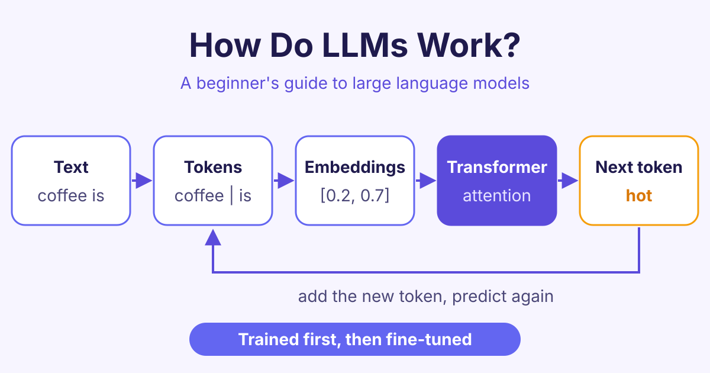

# How Do Large Language Models (LLMs) Work? A Beginner's Guide

*How do LLMs work? A simple guide to tokens, embeddings, attention and next-token prediction, and how a large language model is trained step by step.*

LLMs work by predicting the next small piece of text, called a token, again and again, using patterns they learned from a huge amount of training text. That is the short answer to "how do LLMs work": everything else, from tokens to attention, helps the model make that one guess well.

## What is an LLM?

An **LLM**, or **large language model**, is a computer program that has learned to read and write human language. It is called "large" because it has billions of **parameters** (numbers inside the model that it adjusts while learning) and because it learns from a very large amount of text.

Chat assistants such as ChatGPT, Gemini and Claude are built on LLMs. You type a message, and the model writes a reply one piece at a time.

An LLM does not look up answers in a database. It produces text based on the patterns it learned. This is why it can write in many styles, and also why it can sometimes be wrong while sounding sure.

## How do LLMs work? Step 1: text becomes tokens

A computer cannot read words the way we do. So the first step is to split text into **tokens**: small pieces of text, often a whole word, part of a word, or a punctuation mark.

For example, the sentence "Coffee beans are roasted." might be split like this:

- `Coffee`
- ` beans`
- ` are`
- ` roast`
- `ed`
- `.`

The exact split depends on the model's **tokenizer** (the tool that cuts text into tokens). Each token is then given an ID number from the model's fixed list of tokens, called its **vocabulary**.

## Step 2: Tokens become embeddings

An ID number on its own does not carry meaning. So each token is turned into an **embedding**: a long list of numbers that describes the token.

The model learns these numbers during training. Tokens with similar meanings end up with similar lists. For example, "coffee" and "tea" will be closer to each other than "coffee" and "bicycle".

The model also adds information about the **position** of each token, so it knows that "dog bites man" is different from "man bites dog".

## Step 3: The transformer and attention

Most modern LLMs are built on a design called the **transformer**, first described by researchers at Google in 2017 in a paper called "Attention Is All You Need".

A transformer is made of many **layers** stacked on top of each other. Each layer improves the model's understanding of every token, using what it learned in the layer before.

### What is attention?

The key idea inside a transformer is **attention**. Attention lets each token look at the other tokens and decide which ones matter most for its meaning.

Take the sentence "The cat sat on the mat because it was tired." What does "it" mean? Attention helps the model link "it" strongly to "cat" and only weakly to "mat".

In a model that writes text, each token can only look at the tokens **before** it, not after. This makes sense, because when writing, the future words do not exist yet.

If you want to see each layer step by step, our [How AI Transformers Work](/courses/how-transformers-work) course explains it with simple pictures.

## Step 4: Predicting the next token

After the last layer, the model gives a score to every token in its vocabulary. These scores are turned into **probabilities** (how likely each token is to come next).

For "The coffee is very", the model might rate tokens like this:

| Next token | Chance (example) |
|---|---|
| hot | high |
| strong | high |
| good | medium |
| purple | very low |

The model picks one token, adds it to the text, and runs again to pick the next one. It repeats this until it reaches a stop token or a length limit. This is why chat replies often appear word by word.

A setting called **temperature** controls how the token is picked. A low temperature almost always picks the most likely token, so the answers are steady. A higher temperature allows less likely tokens, so the answers are more varied and creative.

## How are LLMs trained?

Training happens in two main stages.

### Pre-training

In **pre-training**, the model reads a very large collection of text, such as books, websites and code. Its only task is to guess the next token. Each time it guesses wrong, its parameters are adjusted a tiny amount to do better next time.

After billions of these small corrections, the model has learned grammar, facts, and many patterns of reasoning. Pre-training needs a lot of computing power and is the most expensive part.

### Fine-tuning

A pre-trained model is good at continuing text, but it is not yet a helpful assistant. **Fine-tuning** is extra training on smaller, carefully chosen examples, such as questions with good answers.

Many assistants also use feedback from people. People rate or compare the model's answers, and the model is trained to give answers people prefer. This helps it follow instructions, be polite and avoid harmful replies.

## What can LLMs do well, and where do they fail?

LLMs are good at:

- Writing, summarising and translating text
- Answering questions and explaining ideas
- Writing and explaining code

But they have limits:

- They can make up facts that sound real. This is often called **hallucination**.
- Their knowledge stops at the date their training data ends, unless they are given tools such as web search.
- They can only read a limited amount of text at once, called the **context window**.

Knowing how LLMs work helps you use them better: give clear context, check important facts, and use tools when you need fresh information.

## Frequently asked questions

### Does an LLM understand what it writes?

An LLM learns patterns in language very well, and it can use them in useful ways. But it does not think like a person. It predicts likely text, so you should always check important answers.

### What is the difference between AI and an LLM?

AI (artificial intelligence) is the wide field of making computers do tasks that need human-like thinking. An LLM is one type of AI that focuses on language. Other types of AI work with images, sound or numbers.

### Why do LLMs give different answers to the same question?

The model usually picks each token with some randomness, controlled by the temperature setting. Small changes early in a reply lead to different words later. With a temperature of zero, answers become much more consistent.

### Can I build my own LLM?

Yes, you can build and train a very small one on your own computer to learn how it works. Large models like those behind popular chat assistants need huge amounts of data and computing power, so most people fine-tune or use existing models instead.

## Start learning

You now know the main steps: tokens, embeddings, attention, next-token prediction and training. Go deeper with clear lessons and examples in our [How LLMs Work](/courses/how-llms-work) course.
