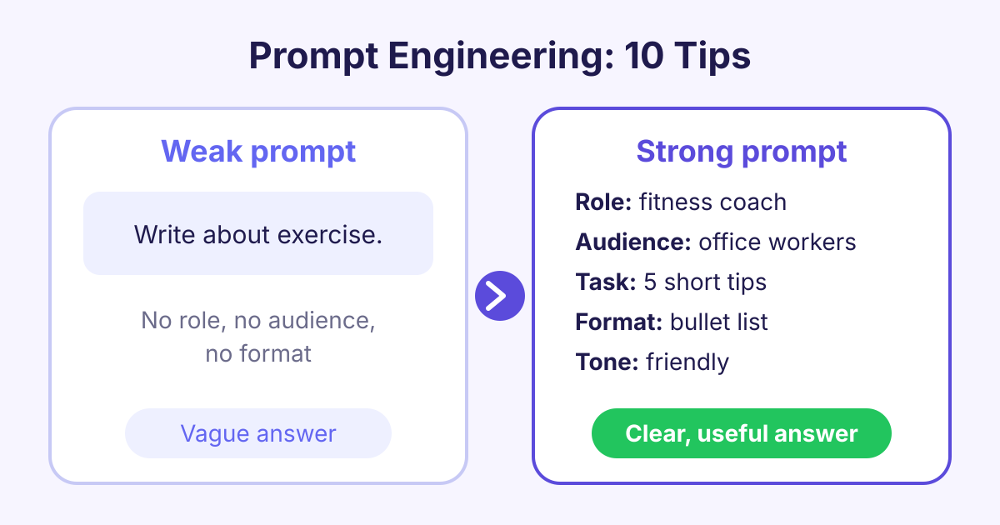

# Prompt Engineering for Beginners: 10 Tips with Examples

*Learn 10 simple prompt engineering tips with before and after examples, so you can get clearer, more useful answers from ChatGPT, Gemini and Claude.*

The best prompt engineering tips come down to one idea: tell the AI exactly what you want, who it is for, and what the answer should look like. A clear, specific prompt with context and an example gets a far better answer than a short, vague one.

## What is prompt engineering?

A **prompt** is the text you type into an AI tool such as ChatGPT, Gemini or Claude. **Prompt engineering** is the skill of writing prompts that get good, reliable answers.

These tools are built on **large language models** (LLMs), which are programs trained on huge amounts of text to predict the next word. An LLM cannot read your mind. It only knows what you put in the prompt. If the prompt is vague, the answer will be vague too.

The good news: you do not need to code. Prompt engineering for beginners is mostly about writing clearly, like giving instructions to a smart new colleague on their first day.

## Why your prompts matter

The same tool can give a weak answer or a great answer. The difference is often just the prompt. A better prompt can:

- Save time, because you need fewer follow-up messages.
- Give answers in the format you need, such as a table or a list.
- Reduce mistakes, because the AI has the facts it needs.

Here are ten simple habits that show you how to write better prompts.

## 10 prompt engineering tips

### 1. Be specific

Vague words give vague answers. Say exactly what you want.

> **Before:** Write about exercise.
>
> **After:** Write 5 short tips to help office workers move more during the working day.

### 2. Give context

Tell the AI the background: who you are, what the situation is and why you need it.

> **Before:** Write an email asking for a day off.
>
> **After:** I work in a small team and our busiest week is next week. Write a polite email to my manager asking for Friday the 14th off for a family wedding.

### 3. Give the AI a role

Asking the AI to act as an expert sets the tone and the level of detail.

> **Before:** Explain inflation.
>
> **After:** You are a friendly secondary school teacher. Explain inflation to a 14-year-old using an example about pocket money.

### 4. Name your audience

The same topic needs different words for a child, a customer or an expert.

> **Before:** Explain how a vaccine works.
>
> **After:** Explain how a vaccine works for adults with no science background. Avoid medical words.

### 5. Ask for a format

Say how the answer should look: a list, a table, headings or a set number of points.

> **Before:** Compare three laptops for students.
>
> **After:** Compare three laptops for students in a table with columns for price range, battery life, weight and best use.

### 6. Set the length and tone

Tell the AI how long the answer should be and how it should sound.

> **Before:** Write a product description for a water bottle.
>
> **After:** Write a 60-word product description for a steel water bottle. Use a warm, friendly tone and no exclamation marks.

### 7. Show an example

Giving one or two examples of what you want is called **few-shot prompting**. The AI copies the style and pattern.

> **Before:** Write slogans for a bakery.
>
> **After:** Write 5 slogans for a bakery. Use this style: "Fresh from the oven, warm from the heart."

### 8. Break big tasks into steps

Large tasks work better in small parts. You can also ask the AI to think step by step.

> **Before:** Plan my small business launch.
>
> **After:** I am opening a small coffee stall. First, list the 5 main tasks for launch. Then wait, and I will ask you about each task one at a time.

### 9. Use clear separators

When you paste text into a prompt, mark where it starts and ends. Quote marks, headings or lines like "---" all work.

> **Before:** Summarise this the meeting went well we agreed the budget and Sam will send the plan...
>
> **After:** Summarise the meeting notes below in 3 bullet points. Notes: """ The meeting went well. We agreed the budget. Sam will send the plan... """

### 10. Improve it step by step

Your first prompt is a draft. Read the answer, then ask for changes. This is called **iterating** (repeating and improving).

> **Before:** (Accepting the first answer, even if it is too long.)
>
> **After:** Good start. Make it half as long, use simpler words and add one real-world example.

## A simple prompt template

You can mix several tips into one template. Copy it and fill in the parts:

> You are a **[role]**. I need **[task]** for **[audience]**. Background: **[context]**. Give the answer as **[format]**, about **[length]**, in a **[tone]** tone. Here is an example of the style I like: **[example]**.

You will not need every part every time. For quick questions, a clear task and a format are often enough.

## Common prompt mistakes to avoid

- **Asking two things at once:** split them into separate prompts or numbered steps.
- **Trusting every fact:** LLMs can **hallucinate**, which means they write false facts that sound true. Always check names, numbers, dates and quotes.
- **Sharing private data:** do not paste passwords, bank details or private customer data into public AI tools.
- **Giving up too soon:** if the answer is weak, change the prompt and try again.

## Frequently asked questions

### Do I need to know coding for prompt engineering?

No. Prompt engineering is mostly clear writing in normal language. Coding helps if you want to use AI inside your own apps, but it is not needed to write good prompts.

### Do these tips work with ChatGPT, Gemini and Claude?

Yes. These tips work with all the main chat tools because they are all built on large language models. Each tool has its own style, so try the same prompt in more than one and compare.

### How long should a prompt be?

As long as it needs to be, and no longer. A simple question may need one line, while a detailed task may need a short paragraph with context, format and an example.

### What is the difference between zero-shot and few-shot prompting?

Zero-shot prompting means you ask the AI to do a task with no examples. Few-shot prompting means you include one or more examples first, which often gives more consistent results.

## Start learning

Good prompts are a skill you can build in a few hours of practice. Start with [Generative AI Fundamentals](/courses/generative-ai-fundamentals) to see how the tools work and practise these tips with real examples. If you build apps, go further with [Prompt Engineering for Developers](/courses/prompt-engineering).
