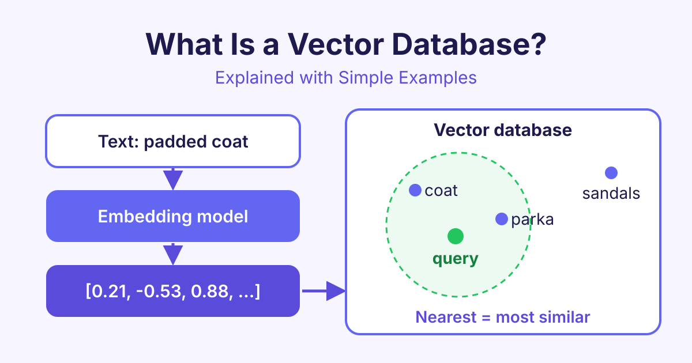

# What Is a Vector Database? Explained with Simple Examples

*What is a vector database? Learn how vector embeddings and vector search help AI apps find text, images and products by meaning, with simple examples.*

A vector database is a database that stores data as vectors (lists of numbers that describe meaning) and finds the items that are most similar to a query. It lets AI apps search by meaning, not just by matching exact words.



## What is a vector database in simple words?

A normal database, such as MySQL or PostgreSQL, is great at exact questions. "Find the customer with ID 42" or "show all orders from May". It looks for values that match exactly.

But people often search by meaning. If you search a shop for "warm winter jacket", you also want to see "padded coat" and "insulated parka". These share almost no words with your search, but they mean nearly the same thing.

A vector database solves this. It stores a list of numbers for every item, and these numbers capture what the item means. To search, it turns your query into numbers too, then finds the items whose numbers are closest.

## What are vector embeddings?

A **vector** is simply a list of numbers, for example `[0.12, -0.48, 0.91]`. A **vector embedding** is a vector made by an AI model (an **embedding model**) to describe a piece of data.

The model reads a sentence, an image or a product description and outputs a long list of numbers. Real embeddings usually have hundreds or a few thousand numbers. Each number is called a **dimension**.

The useful part is this: **similar meaning gives similar numbers.** Imagine a map where each word is a dot:

- "cat" and "kitten" sit very close together.
- "dog" is a little further away.
- "car" is far away from all of them.

An embedding is like the position of a dot on that map, but with many more directions than a paper map has. Here is a short Python example using the free `sentence-transformers` library:

```python
from sentence_transformers import SentenceTransformer, util

model = SentenceTransformer("all-MiniLM-L6-v2")

texts = ["warm winter jacket", "padded coat", "summer sandals"]
vectors = model.encode(texts)

print(len(vectors[0]))  # 384 numbers per text

# Higher score = closer in meaning
print(util.cos_sim(vectors[0], vectors[1]))  # jacket vs coat: high
print(util.cos_sim(vectors[0], vectors[2]))  # jacket vs sandals: lower
```

## How does vector search work?

**Vector search** (also called similarity search or semantic search) means finding the stored vectors that are closest to a query vector. It works in four steps:

1. **Embed your data.** Turn each document, image or product into a vector with an embedding model.
2. **Store the vectors.** Save each vector in the vector database, together with an ID and extra details called **metadata**, such as the title, date or price.
3. **Embed the query.** When a user searches, turn their query into a vector with the same model.
4. **Find the nearest neighbours.** The database returns the items whose vectors are closest to the query vector.

### How is "closest" measured?

The database uses a **distance metric**, a formula that measures how close two vectors are. Common ones are:

- **Cosine similarity**: compares the direction of two vectors. Very common for text.
- **Dot product**: similar to cosine, and fast.
- **Euclidean distance**: the straight-line distance between two points.

### Why not just compare every vector?

With a few thousand items, you could compare the query with every vector. With millions, this becomes too slow. So vector databases build a special **index** (a structure that speeds up search). A popular one is **HNSW** (Hierarchical Navigable Small World), which links vectors into layers of neighbours, so the search can jump quickly towards the right area.

This is called **approximate nearest neighbour** (ANN) search. It may sometimes miss the perfect match, but it is much faster. Our [Vector Databases](/courses/vector-databases) course explains indexes like HNSW step by step.

## Vector database vs traditional database

| | Traditional database | Vector database |
|---|---|---|
| Stores | Rows, columns, text, numbers | Vectors plus metadata |
| Search type | Exact match, filters, ranges | Similarity by meaning |
| Example query | "price < 50" | "something like this jacket" |
| Best for | Orders, users, payments | Semantic search, RAG, recommendations |

They are not rivals. Most apps use both. Many traditional databases can now store vectors too, for example PostgreSQL with the **pgvector** extension.

## Popular vector databases

Here are some well-known options:

- **Qdrant**: open source, written in Rust, easy to run locally or in the cloud.
- **Pinecone**: a fully managed cloud service.
- **Weaviate** and **Milvus**: open source, built for large collections.
- **Chroma**: open source and simple, popular for small projects and prototypes.
- **pgvector**: adds vector search to PostgreSQL.

The best choice depends on your data size, budget and whether you want to host it yourself.

## What are vector databases used for?

- **Semantic search**: search help articles or documents by meaning.
- **RAG (retrieval-augmented generation)**: find the right text and give it to an LLM (large language model) so it can answer from your own documents. Our [Building RAG Applications](/courses/building-rag-applications) course shows how.
- **Recommendations**: suggest products, songs or films similar to ones a user liked.
- **Image search**: find photos that look like another photo.
- **Duplicate detection**: spot questions or support tickets that ask the same thing in different words.

## Frequently asked questions

### Is a vector database the same as an embedding model?

No. The embedding model turns data into vectors. The vector database stores those vectors and searches them. You need both for vector search.

### Do I need a vector database for a small project?

Not always. For a few thousand items, you can keep vectors in memory or use a simple library. A vector database helps when your data grows, or when you need filters, updates and fast search.

### Can a vector database store text and images?

It stores vectors for them, plus metadata such as the original text or an image link. Some embedding models can put text and images into the same space, so you can search photos with words.

### Is vector search better than keyword search?

It is better at meaning, but keyword search is better at exact terms like product codes or names. Many apps use **hybrid search**, which combines both for the best results.

## Start learning

Vector databases are a key part of modern AI apps, and the ideas are easier than they look. Start our [Vector Databases](/courses/vector-databases) course to build your own vector search with hands-on labs.
