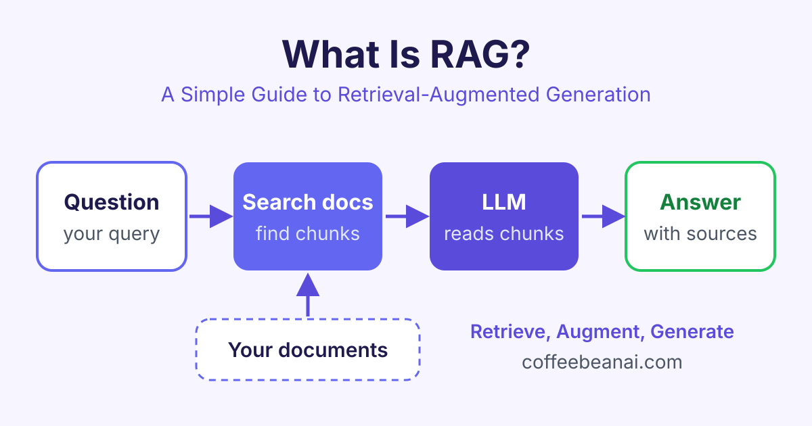

# What Is RAG? A Simple Guide to Retrieval-Augmented Generation

*What is RAG? Learn how retrieval-augmented generation lets an AI model look up your own documents before it answers, with simple steps and examples.*

RAG (retrieval-augmented generation) is a way to make an AI model answer questions using your own documents. Before the model writes an answer, the system searches your files, finds the most useful pieces of text and gives them to the model to read.



## What is RAG in simple words?

A large language model (LLM) is an AI model that has read a huge amount of text. Chat tools such as ChatGPT, Claude and Gemini are built on LLMs. It is very good at writing ([How LLMs Work](/courses/how-llms-work) explains why). But it has two big limits:

- It only knows what was in its training data, up to a certain date.
- It has never seen your private files, such as your company handbook or your product manuals.

When you ask an LLM about something it does not know, it may guess. A wrong answer that sounds confident is called a **hallucination**.

RAG fixes this with a simple idea. Think of an open-book exam. Instead of answering from memory, the student first looks up the right page in the book, then writes the answer. In RAG, the "book" is your documents and the "student" is the LLM.

The name explains the three parts:

- **Retrieval**: find the right text.
- **Augmented**: add that text to the question.
- **Generation**: the LLM writes (generates) the answer.

## How does RAG work?

A RAG system has two stages. The first stage happens once, before anyone asks a question. The second stage happens every time a user asks something.

### Stage 1: prepare your documents

1. **Load** your files, for example PDFs, web pages or help articles.
2. **Split** them into small pieces called **chunks**, often a few paragraphs each. Small chunks are easier to search and fit better in the model's input.
3. **Embed** each chunk. An **embedding** is a list of numbers that captures the meaning of the text. Texts with similar meaning get similar numbers.
4. **Store** the embeddings in a **vector database**, a database built to find similar lists of numbers quickly.

### Stage 2: answer a question

1. The user asks a question.
2. The question is turned into an embedding with the same model.
3. The vector database returns the chunks that are closest in meaning.
4. These chunks are pasted into the **prompt** (the text you send to the LLM), together with the question.
5. The LLM reads the chunks and writes an answer based on them. It can also show which documents it used.

Here is the idea in a few lines of Python. The `search` and `ask_llm` functions stand for your vector database and your LLM.

```python
question = "How many days of holiday do new staff get?"

# 1. Retrieval: find the 3 most relevant chunks
chunks = search(question, top_k=3)

# 2. Augmentation: put the chunks into the prompt
context = "\n\n".join(chunks)
prompt = f"""Answer using only the text below.
If the answer is not there, say you do not know.

Text:
{context}

Question: {question}"""

# 3. Generation: the LLM writes the answer
print(ask_llm(prompt))
```

If you want to see how embeddings and similarity search work in detail, our [Vector Databases](/courses/vector-databases) course covers them step by step.

## Why use RAG? The main benefits

RAG has become one of the most common ways to build AI apps for real work. Here is why:

- **Fewer made-up answers.** The model answers from real text, not only from memory.
- **Up-to-date knowledge.** When a document changes, you update the database. You do not need to retrain the model.
- **Private data stays yours.** You can use internal files without putting them into a model's training data.
- **Sources you can check.** The app can show links to the chunks it used, so users can check the answer.
- **Lower cost.** Adding documents to a database is much cheaper than training a model.

RAG does not remove every mistake. If the search returns the wrong chunks, the answer can still be wrong. That is why good chunking and good search matter so much.

## RAG vs fine-tuning

**Fine-tuning** means training an existing model a little more on your own examples, so it changes its behaviour. People often ask which one to choose.

| | RAG | Fine-tuning |
|---|---|---|
| What it changes | The information the model reads | The model itself |
| Best for | Facts, documents, changing data | Style, tone, fixed formats |
| Updating knowledge | Add or edit documents | Train again |
| Shows sources | Yes, easily | No |
| Cost to start | Low | Higher |

A simple rule: use RAG when the model needs to **know** something, and fine-tuning when it needs to **behave** in a certain way. Many teams use both.

## Where is RAG used today?

You can find RAG in AI tools you may already use:

- **Customer support bots** that answer from a company's help centre.
- **Internal search assistants** that answer staff questions from policies, wikis and reports.
- **Legal and research tools** that find and summarise the right passages in long documents.
- **Coding assistants** that look up a project's own code and docs before suggesting changes.
- **AI search engines** that search the web, then write a short answer with links.

## Common problems and how to fix them

Building a simple RAG demo is quick. Making it reliable takes more care. Here are common problems:

- **Chunks are too big or too small.** Big chunks add noise. Tiny chunks lose context. Test a few sizes and add some overlap between chunks.
- **The search misses the right text.** Try **hybrid search**, which mixes meaning-based search with normal keyword search. A **reranker** (a second model that sorts results by relevance) also helps.
- **The model ignores the context.** Write a clear prompt that says "answer only from the text below".
- **No way to measure quality.** Keep a small set of test questions with known answers, and check them each time you change something.

You can practise each of these fixes with hands-on labs, using real documents and real questions.

## Frequently asked questions

### Is RAG the same as an LLM?

No. An LLM is the model that writes text. RAG is a method that adds a search step before the LLM, so the model gets the right information to read first.

### Do I need a vector database for RAG?

Not always. Small projects can search with keywords or keep embeddings in memory. For larger collections of documents, a vector database makes search fast and easy to manage.

### Does RAG stop hallucinations completely?

No, but it reduces them a lot. The model can still misread the text or the search can return the wrong chunks. Showing sources and testing with real questions help you catch these cases.

### Can I build RAG without coding?

Yes, to a point. Several AI tools let you upload files and chat with them, and this uses RAG behind the scenes. To control chunking, search and prompts, you will need some basic Python.

## Start learning

The best way to understand RAG is to build one yourself, from loading documents to answering questions with sources. Start with our [Building RAG Applications](/courses/building-rag-applications) course and build your first RAG app step by step.
